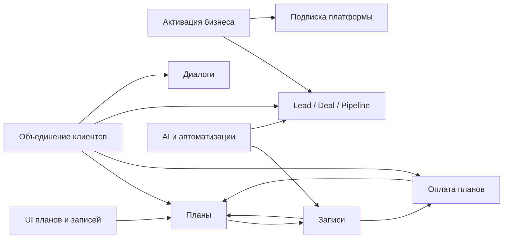

# CRM-D04: ядро, общие модули и стоматологический профиль

Дата: 21.11.2026. Статус: **план и карта текущих зависимостей**, не реализованный
механизм регистрации. Владелец направления: [CRM-D04 в roadmap](roadmap.md).
Пользователь поручил документирование и анализ связей; изменения приложения,
активация профилей, миграции рабочих данных и deployment не разрешены этой задачей.

## Контракт текущей задачи и срез

Режим: документация + анализ исходников. Gap: roadmap/evidence; это не доказанный
дефект приложения. Результат: распределение возможностей, карта прямых связей,
порядок безопасного разделения и критерии будущих проверок.
Корень: `C:/Users/user/Desktop/PlatformaCRM`; ветка `codex/ui-testing-toolkit`;
исходный HEAD `02682f04cdd9591302707e3b8f4e9fb799f4e485` плюс чужой WIP.
Уточнение владельца21.11 зафиксировано на `9bbca1018c63a29884e500982f51e632655e96ea`:
только однократный серверный выбор профиля при регистрации, без управления модулями.
Изменения auth/Google/password/integrations и существующие правки STATUS/PRIMARY
не принадлежат этой задаче. В общих индексах добавляются только отдельные записи.
Собственных серверов, браузеров, БД или фоновых процессов нет.

Предыдущий результат: план с предложениями смены/отключения → явное сужение scope
владельцем → удаление этих сценариев из будущего плана без изменения кода и карты
исходного среза. Использован `zani-analyze-crm-product`: факты отделены от предложений,
проверены входы/права и сохранение сквозных сценариев. UI не меняется.

Приёмка этой фазы: план зарегистрирован; все выводы карты имеют источники;
roadmap/паспорт/индексы согласованы; ссылки, JSON и diff hygiene проверены.
Runtime/build/browser/DB проверки не нужны для docs-only и не запускаются.
Изменений permissions, уведомлений, BusinessEvent, AI, API или среды нет.
Обычная публикация только собственного проверенного документационного commit
по AGENTS.md; чужие исходники и чужие правки документов не включаются.

## Целевая принадлежность

Это логические границы. Django app не равен отраслевому продуктовому модулю.
На первом цикле сохраняются таблицы, app labels, ID, URL, форматы API и миграции.

| Слой | Возможности и текущие области кода |
| --- | --- |
| Общее ядро | `accounts`, `businesses`: идентичность, Business, сотрудники, права и tenant isolation; `branches`: филиалы; `clients`: общая карточка/идентичность клиента; `services`, базовый `scheduling`: услуги, специалисты, ресурсы, запись, календарь, доступность |
| Общие механизмы | `core`, `activities`, `notifications`: команды, транзакции, идемпотентность, аудит, история и доставка уведомлений; общий frontend/API/i18n; базовые механизмы AI/голоса, адаптеров интеграций и аналитики |
| Планы посещений | `scheduling/plan_*`, VisitPlan/VisitPlanStep, компоненты планов; зависит от клиентов, услуг, записей, филиалов и прав |
| Оплаты клиентов | `payments`: поступления, возвраты, история; существующие связи Appointment/Deal сохраняются |
| Оплата планов | `payments/plan_*`, terms/allocations/remainders/corrections: общий модуль, зависит от планов и оплат; не стоматологическая финансовая подсистема |
| Коммуникации | `conversations`, соответствующая Inbox-часть `bots`, каналы `integrations`; отделять инфраструктуру доставки от включаемых сценариев |
| Работа и автоматизации | `tasks`, `automations`; доступ к каждому вызываемому домену остаётся обязательным |
| Продажи | `leads`, `crm`: Lead/Deal/pipeline; backend/history остаются независимо от скрытой навигации пилота |
| Рассылки и расширенные отчёты | `outreach`, соответствующие части `analytics`; зависят от доступных источников данных и каналов, не расширяют отложенный Market scope |
| Будущий клиентский кабинет | Общий дополнительный модуль с отдельной клиентской границей доступа; пока предложение, не факт реализации |
| Контур платформы | `billing`, `pricing`, `support`, платформенная администрация: не платежи клиентов и не стоматологический профиль |
| Сборка сценария | `onboarding`, `businesses/activation`: оркестрация первоначальной настройки; предполагаемое место применения профиля, а не независимый отраслевой домен |

Ядро работает без отраслевых расширений; расширение использует ядро. Отдельные
серверы, БД, репозитории и динамическая установка Django apps не требуются.
Общие механизмы AI/аналитики могут оставаться в ядре при отключённых пользовательских
возможностях. Физические границы перечисленных apps не заявлены уже очищенными.

## Стоматологический профиль v1: предложение

Профиль выбирает существующие общие возможности: клиент, запись, план посещений,
оплаты/оплата плана, Inbox, задачи и согласованные AI-сценарии администратора.
Ресурсы кабинета/оборудования используют общую модель. Новые таблицы профиля
нужны только при появлении собственных данных, а не ради названия отрасли.
Состав и содержимое шаблонов услуг/напоминаний ещё требуют определения; реальные
данные бизнеса и ручные настройки не заменяются шаблоном.

Общие названия остаются «Клиент», «Специалист», «Бизнес». Профиль не глобально
переименовывает интерфейс. Клиническая карта, диагнозы, зубная формула, лечебные
протоколы и кабинет пациента не входят в эту фазу. Будущие отраслевые сущности
ссылаются на общих клиента/запись/план, не создают DentalClient/DentalAppointment.
Салон нужен как контрольный сценарий общего ядра; полноценный beauty-модуль
не является поручением этой задачи.

## Решение владельца21.11: профиль при регистрации

Цель — внутреннее разделение серверной логики и состава интерфейса. Пользователь
выбирает сферу при регистрации/создании бизнеса, сервер один раз определяет
профиль, и первый рабочий экран содержит общее ядро и возможности выбранной сферы.
Профиль принадлежит Business, а не аккаунту: сотрудники получают конфигурацию
своего бизнеса; приглашение нового сотрудника не применяет профиль повторно.

Не разрабатываются экран управления модулями, ручные переключатели, смена сферы
после создания бизнеса, отключение/повторное включение, архивные состояния модулей,
preview обновления профиля и система пользовательских overrides состава модулей.
Ранее предложенная четырёхсостоянийная модель не принята и не является зависимостью.
Существующее поведение настройки бизнеса не изменено этим документом; отсутствие
нового сценария смены сферы не означает, что текущий API уже запрещает её изменение.

Предлагаемый серверный поток будущей реализации:

1. Общий сервис создания Business принимает выбранную сферу. Регистрация пользователя
   сама по себе, повторный вход и приглашение сотрудника не запускают настройку профиля.
2. Сервер проверяет сферу по поддерживаемому реестру и выбирает фиксированное описание:
   общие возможности + отраслевые расширения + необходимые зависимости. Клиент
   передаёт сферу, но не произвольный список разрешённых модулей.
3. В рамках создания бизнеса сохраняются выбранный профиль/идентификатор его версии
   и фактические capabilities с использованием существующего BusinessCapability.
   Версия нужна для воспроизводимости и диагностики, не для экрана обновлений.
4. Первоначальная настройка атомарна и идемпотентна: ошибка откатывает частичные
   данные, повтор не создаёт дубли и не перезаписывает уже созданную конфигурацию.
   Существующие механизмы создания бизнеса/подписки переиспользуются.
5. Frontend получает эффективные возможности от сервера и собирает доступные разделы,
   карточки и действия. Новый интерфейс управления модулями не нужен. Пока настройка
   не завершена, не показывается неподходящий полный набор функций как запасной вариант.
6. API, AI-инструменты и фоновые команды применяют тот же серверный набор возможностей
   плюс действующие роль/tenant/branch/object проверки. Скрытие раздела не заменяет доступ.

Обычные рабочие настройки бизнеса (цены, графики, услуги, уведомления) сохраняются
в своих существующих сценариях. Defaults профиля применяются только при создании,
не при каждом входе, запросе capabilities или регистрации сотрудника. Дополнительная
система отслеживания происхождения каждого значения и слияния overrides не требуется.
Изменение определения профиля разработчиком не должно молча перенастраивать старые
бизнесы. Обработка уже существующих данных — отдельная техническая совместимость,
а не пользовательская функция смены профиля; массовая миграция здесь не поручена.

Для ещё не реализованной сферы нельзя выдавать общий профиль за готовый отраслевой
модуль. До кода нужно определить поддерживаемый стартовый набор сфер и явный общий
вариант, затем точное соответствие сфера → возможности. Это состав серверного
реестра, не новая система пользовательского управления. Dentistry — первый профиль;
полноценная реализация остальных отраслей не входит в текущую задачу.

## Карта текущих зависимостей

Метод: выборочное статическое чтение определений, импортов, вызовов и ссылок
моделей. Это карта существенных границ, не исчерпывающий граф всех импортов,
не новая runtime-сертификация и не полный security review.

| Граница | Что уже отделено / фактическая связь | Следствие для разделения |
| --- | --- | --- |
| Business → возможности | [Business/BusinessCapability](../../apps/businesses/models.py), [реестр](../../apps/businesses/capabilities.py): отдельные записи по Business; `business_type` есть, defaults одинаковы, `workflow_mode=standard_crm` | Использовать существующий механизм, а не создавать параллельный; готового отраслевого профиля нет |
| Defaults → сохранённые настройки | `apply_business_type_defaults` использует update_or_create; unknown key fallback разрешающий | Применять профиль однократно при создании; повтор/вход не перезаписывает настройки. Строгие новые ключи требуют проверки совместимости старых потребителей |
| Активация бизнеса → продажи/подписка | [activation](../../apps/businesses/activation.py) напрямую импортирует Subscription, Pipeline/Stage и Lead/Form | Создание бизнеса уже оркестрирует несколько доменов; профиль добавляется в этот поток без удаления зависимостей Lead/Deal |
| План → запись | [модели](../../apps/scheduling/models.py): VisitPlanStep имеет nullable OneToOne Appointment, Service, Resource, Branch; [plan_services](../../apps/scheduling/plan_services.py) вызывает record_commands | Этап без даты не должен создавать пустой Appointment; сервисы уже выделены, но зависят от общего scheduling |
| Запись → план → деньги | [scheduling services](../../apps/scheduling/services.py): lock_appointment_plan/touch_appointment_plan, completion вызывает allocate_completed в atomic; [plan lifecycle](../../apps/scheduling/plan_lifecycle.py) | Критическая синхронная связь. Не переносить зачёт в фоновый обработчик; сохранять транзакцию, версии и порядок блокировок |
| Деньги ↔ планы | [payment models](../../apps/payments/models.py): FK на VisitPlan/Step; [plan money services](../../apps/payments/plan_services.py) использует plan_access и приватный `_effect` из plan_services | Сервисы выделены по файлам, но есть обратная связь к scheduling. Будущий публичный интерфейс эффектов обоснован этой связью; перенос сейчас не выполняется |
| Доступ к плану → клиенты/записи/филиалы | [plan_access](../../apps/scheduling/plan_access.py): проверки CLIENTS/APPOINTMENTS и branch; [plan_selectors](../../apps/scheduling/plan_selectors.py): доступные шаги/планы | Нет отдельного ключа visit_plans в реестре. Новый gate дополняет, не заменяет объектные права; чтение тоже нужно проверить |
| Платежи → capability клиентов | RESOURCE_MODULES в capabilities отображает payments на clients | Если состав профилей различает оплаты, понадобится серверная граница и проверка callers; пользовательское выключение не требуется |
| Merge клиента → многие домены | [client services](../../apps/clients/services.py) импортирует Appointment/VisitPlan, Payment, Deal, Lead, Conversation, BotConversation, Task, activity/analytics | Общая карточка не независима от дополнительных данных. Merge должен сохранять связи и деньги даже при скрытом UI модуля |
| AI → бизнес-домены | [tool registry](../../apps/ai_core/tool_registry.py), [approval](../../apps/ai_core/crm_approval.py): прямые зависимости от CRM/автоматизаций и проверки прав/approval | Реестр инструментов уже есть; отделение отраслевых инструментов должно сохранить текущие права, fingerprint, expiry и повторную проверку перед действием |
| Автоматизация → доменные команды | [engine](../../apps/automations/engine.py): capability checks, назначение Lead/Deal/Task, appointment follow-up, Inbox assignment | Очередь и повторное исполнение не должны обходить актуальную доступность; отсутствие пункта меню ничего не запрещает |
| Диалоги → задачи | [conversation services](../../apps/conversations/services.py) использует create_automation_task и capability guard | Handoff/следующее действие пересекают границу модулей; проверить поведение при недоступных задачах |
| Frontend планы → запись и деньги | [API](../../frontend/src/api/visitPlans.ts) выделен; [RecordsPage](../../frontend/src/features/calendar/RecordsPage.tsx) выбирает планы по view=plans; [AppointmentPlanPanel](../../frontend/src/features/calendar/AppointmentPlanPanel.tsx), PlanMoneyDialog/PlanCorrectionDialog используют план API | Компоненты есть, но продуктовая доступность требует проверки вкладки, вложенной панели, deep links и денежных диалогов |
| Frontend → capabilities | [permissions](../../frontend/src/lib/permissions.ts): отсутствующее false трактуется как разрешение | Сервер остаётся authority; новый payload/кеш должны корректно обновляться при смене Business и доступности |

Стрелки показывают вызовы/данные, не права владения:

Вывод: уже есть функциональная декомпозиция (сервисы/selectors/API/UI), но
серверное назначение отраслевого набора и строго односторонние зависимости ещё
не обеспечены. Прямая зависимость сама по себе не дефект; денежная атомарность
важнее архитектурной чистоты. Аналитические проекции, exports/imports, все каналы
и все очереди не прослежены исчерпывающе: расширять карту перед изменением
конкретной границы, не начинать новый общий аудит.

## Последовательность будущей реализации

| Шаг | Минимальная дельта | Критерий завершения |
| --- | --- | --- |
| 0. Карта и исходное поведение | Этот документ; при начале кода дополнить callers конкретного gate и сопоставить evidence с кандидатом | Существенные связи названы; пробелы явно отмечены. Статическая часть выполнена, runtime baseline ещё не проверен |
| 1. Состав профиля | Определить поддерживаемые сферы, ключи и зависимости возможностей | Есть явная таблица сфера → набор; пользовательское управление модулями исключено |
| 2. Серверный реестр | Использовать BusinessCapability и фиксированные определения профилей | Новые ключи/зависимости валидируются; старое поведение сохраняется без массовой перенастройки |
| 3. Границы доменов | Серверные gates планов/оплаты там, где различается состав профилей; сохранить таблицы/API/атомарность | Одиночная запись работает в общем наборе; планы и денежные обязательства сохраняют целостность |
| 4. Создание бизнеса | Однократное атомарное/идемпотентное назначение профиля по выбранной сфере | Нет частичной настройки/дублей; повтор входа или приглашение сотрудника не применяют defaults |
| 5. UI и AI | Серверная доступность для навигации, вложенных панелей, deep links и инструментов | Нет stale доступов, обходов API/AI/queue; RU/KK/EN и recovery проверены |
| 6. Совместимость | Проверить текущие бизнесы и записи без назначения им профиля задним числом | Настройки, история, ID и остатки прежние; пользовательская смена/миграция профиля не добавлена |
| 7. Совместная приёмка | Один кандидат: dentistry и нейтральный бизнес с другим набором | Пройдены связанные backend/PG/UI и требуемый общий gate; deployment отдельно |

Это порядок зависимостей, не разрешение выполнить все шаги. Первый runtime-результат:
одна сборка, общий scheduling, серверные границы планов/оплаты и профиль новых
бизнесов. Создание клинических сущностей, нового permission framework и перенос
моделей между apps не входят в первый цикл.

## Следующая техническая конкретизация

Определить точный состав dentistry и общего профиля, поддерживаемые сферы,
все входы создания Business и формат серверного payload. Шаблоны добавлять только
при необходимости и с определённым содержимым. Смена сферы, отключение, владельцы
переключателей и обновление overrides больше не являются открытыми вопросами или
блокерами: они исключены владельцем из scope. Правила денег и прав остаются прежними.

## Проверки будущих изменений и сохранение выполненного

Переиспользовать `apps/scheduling/tests_visit_plans.py`, `tests_plan_concurrency.py`,
`apps/payments/tests_plan_payments.py`, `tests_plan_concurrency.py`,
`tests_plan_termination.py`, `tests_plan_corrections.py`, `tests_plan_migration.py`.
Историческая граница: [планы и оплаты](../testing/evidence/visit-plan-payments-20261118.md).
Существующий PASS не сертифицирует изменённый кандидат; закрытые функции не
переписываются без нового дефекта/требования.

Матрица: одиночная запись; план и неназначенные этапы; аванс/зачёт ровно один раз;
отмена/перенос без списания; возврат/остаток/correction/legacy attachment; merge;
role/tenant/branch denial; API/AI/queue bypass; stale revisions и response-loss retry;
конкурентные completion/refund; назначение профиля при создании Business;
неподдерживаемая сфера/подмена списка модулей; rollback создания; повтор регистрации
без дублей/сброса настроек; вход и приглашение сотрудника без повторного применения;
RU/KK/EN, keyboard/focus, empty/loading/error/input recovery и реальные screenshots.

После каждой backend-дельты: focused isolated tests. На завершении: affected/dependent
suites, system/migration drift, PostgreSQL для конкуренции, build/types и целевые
UI-сценарии. Сквозной кандидат требует общего gate по [testing](../testing/testing.md)
с действительным base и acceptance-specific проверками. Рабочая БД не используется.
Откат сначала проектируется как возврат совместимого поведения без удаления новых
данных; обратная миграция не считается автоматически безопасной.

## Результат текущей документационной фазы

Сделано: зафиксированы план, предложенная принадлежность, исходные связи и риски.
Код: изменений нет, реализация будущих шагов не начата. Evidence: статическое чтение;
runtime baseline и полная матрица не выполнялись. Среда: без изменений и deployment.
Решение владельца: однократный серверный выбор по сфере; пользовательское управление
модулями исключено. Состав серверного реестра ещё предстоит конкретизировать.
В принятом docs-only scope остаток после проверки ссылок/публикации отсутствует;
следующий незакрытый критерий будущей реализации — таблица сфер/возможностей и
точки создания бизнеса, затем проверка выбранной границы. План не закрывает AC пилота.
README приложения не меняется: setup и runtime-поведение прежние. Product/CRM/access
сохраняют действующие правила: предложения здесь не заменяют их. Паспорт возможностей
и roadmap получают ссылку на эту ограниченную фазу; исторические evidence не меняются.
