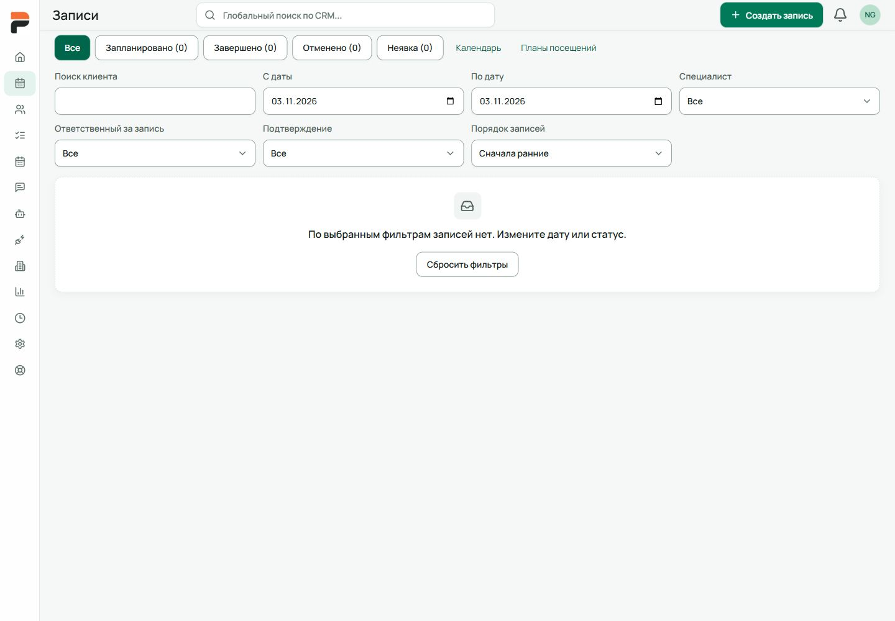

# APPOINTMENTS-UI-AUDIT-20261103

## Вывод

«Записи» требуют компактной локальной шапки списка вместо постоянно раскрытой
сетки фильтров. Сохраняем общий фиксированный Header, существующие статусы, API,
URL-фильтры и токены. За основу взаимодействия — поиск + кнопка «Фильтры» +
активные условия, как на «Клиентах»; период остаётся видимым, как в календаре.
Это предложение по поручению владельца, **изменений продуктового кода нет**.

## Снимки и граница

[Desktop1440×1000](appointments-ui-audit-20261103-assets/appointments-desktop.jpg),
[mobile390×844, полная страница](appointments-ui-audit-20261103-assets/appointments-mobile.jpg).

Канонический checkout, `codex/ui-testing-toolkit`, HEAD `e02a28f5` + существующий WIP.
Chrome, dev5173/backend8000, роль владельца, RU, текущий Business, пустой результат
на03.11.2026. Сопоставлены браузер и исходники «Клиентов», «Календаря», «Задач».
Открывались только фильтры; значения/настройки не сохранялись, сущности не менялись.
Полный список с данными и ошибка загрузки не воспроизводились заново: текущая
задача проверяет композицию фильтров; предыдущие функциональные проверки —
[отдельный срез](records-bell-fix-20261103.md), не новая сертификация.

[Измерения DOM](appointments-ui-audit-20261103-assets/measurements.json),
[хеши прочитанных исходников](appointments-ui-audit-20261103-assets/source-manifest.json).
Проверка RU; длинные KK/EN подписи, другие роли/филиалы, screen reader, контраст
и производительность в этом аудите не сертифицированы. Общий Header48px desktop/
56px mobile плюс граница уже реализован и не требует нового изменения высоты.

## Находки

| ID / приоритет | Доказательство и влияние | Минимальная корректировка |
|---|---|---|
| AP01 · P2 | `RecordsPage.tsx:107–115`: поиск, две даты, специалист, ответственный, подтверждение и сортировка представлены равноправными полями. На1440px grid занимает156px; на390px —576px, y261–837. Текст результата начинается околоy934 при высоте экрана844. Пользователь сначала прокручивает форму фильтров, чтобы узнать результат. DOM + screenshot | Оставить поиск и один контрол периода в локальной панели. Дополнительные параметры открывать по кнопке «Фильтры». На мобильном компактные строки и отдельный диалог, без разворачивания формы в потоке. |
| AP02 · P2 | `RecordsPage.tsx:102–105,122`: краткое описание/сброс предусмотрены только для client/attention, общий сброс находится в пустом состоянии. Для непустого списка с ответственным/специалистом/подтверждением универсальный сброс отсутствует. Перенос полей в окно без обзора активных условий дополнительно скроет причину отбора. Source finding; текущий пустой экран сам по себе не доказывает непустой сценарий | Показывать активные условия с индивидуальным удалением, общий «Сбросить» и число дополнительных условий на кнопке. Период показывать всегда, включая дефолтный «Сегодня». |
| AP03 · P3 | `RecordsPage.tsx:94–100`: «Календарь» и «Планы посещений» стоят в одной группе со статусами. На телефоне элементы переносятся на несколько строк; переход на другой экран смешан с фильтрацией текущего. DOM + source | Отделить ссылки навигации в правую часть локальной шапки/отдельную компактную группу. Статусы оставить собственной группой; на телефоне горизонтальная прокрутка вместо многострочного набора крупных кнопок. |
| AP04 · P3 | `RecordsPage.tsx:115`: «Порядок записей» — широкое поле с постоянным label рядом с ограничениями выборки. Оно конкурирует с периодом и поиском, хотя меняет только порядок. Source + screenshot | Компактное меню сортировки справа от панели или сортировка колонки даты; сохранить текущие start_at/-start_at и доступное название. |

Положительные стороны: существующие Input/Select/Button с общими токенами;
подписи у полей; статусные счётчики; явное пустое состояние; отдельное создание
записи в хедере; URL хранит выбор, смена условий сбрасывает пагинацию. На390px
горизонтального переполнения страницы нет. Эти механизмы сохраняем.

## Как устроены другие страницы

| Страница | Проверенная реализация | Что использовать |
|---|---|---|
| Клиенты | `ClientsFilters.tsx` → `CrmFilterControls.tsx:45,55,70–104`: поиск/кнопка фильтров, быстрые условия, chips; отдельный Dialog с черновиком, «Отмена», «Применить», «Сбросить». Открыт в браузере | Основной образец группировки и применения нескольких дополнительных условий. Применение не сдвигает список раскрытой формой. |
| Календарь | `CalendarToolbar.tsx:78–120`: видимый период/переключение вида, поиск, «Фильтры» с количеством; услуги/ресурсы/статус в Modal. Открыт в браузере | Период — заметный рабочий контекст, вторичные параметры скрыты. Здесь фильтры применяются сразу; не смешивать эту семантику с кнопкой «Отмена» из другого паттерна. |
| Задачи | `TasksPage.tsx:81–94`: поиск + кнопка, быстрые состояния; дополнительные поля раскрываются в карточке. Открыто/закрыто в браузере | Оставить быстрые состояния видимыми. Раскрытие большой формы со сдвигом содержимого для «Записей» не переносить. |

Единого идентичного механизма на всех страницах сейчас нет. Нельзя считать любой
из существующих вариантов универсальным стандартом без учёта сценария.

## Предлагаемая композиция

1. **Общий Header:** «Записи», глобальный поиск, «Создать запись», колокольчик,
   аккаунт. Сохраняем текущие высоту и фиксацию, не помещаем сюда семь полей.
2. **Локальная шапка списка:** поиск клиента; один контрол периода с текущим
   значением; «Фильтры (N)»; компактная сортировка. На desktop специалист может
   остаться быстрым выбором, если это подтвердится рабочим сценарием; базовый
   минимальный вариант держит его вместе с дополнительными условиями.
3. **Следующая строка:** «Все / Запланировано / Завершено / Отменено / Неявка»
   со счётчиками. «Календарь» и «Планы посещений» — отдельные действия справа.
4. **Только при выборе условий:** chips «Специалист…», «Ответственный…»,
   «Подтверждение…», «Филиал…», «Клиент…»/attention и общий сброс.
5. **Окно фильтров:** специалист, ответственный, подтверждение, филиал при наличии.
   Черновик применяется одной операцией; «Отмена» оставляет текущий список.
   Период с быстрым «Сегодня»/«Неделя» и произвольным диапазоном — предложение,
   текущий дефолт «Сегодня» сохраняется. Семантику «Все даты» не менять неявно:
   сейчас «Все» относится к статусам, а не ко всему историческому периоду.

**Mobile:** поиск + кнопка фильтров; ниже компактный период, затем одна прокручиваемая
строка статусов. Окно фильтров с доступными footer-кнопками, focus/Escape/return.
Результаты должны появляться на первом экране при стандартных фильтрах390×844;
не добиваться этого уменьшением полей ниже текущего удобного размера.

Если нужен триггер именно в верхней фиксированной полосе, `PageHeaderContext`
уже поддерживает filters/activeFilterCount. Но `Header.tsx:83–84` сейчас размещает
его внутри `hidden lg:flex`: простой перенос туда потеряет доступ на мобильном.
Поэтому рекомендуем единый локальный toolbar на всех ширинах. Дополнительную
фиксацию toolbar при скролле следует проверять отдельно, чтобы он не перекрывал
первую строку таблицы и не занимал слишком много высоты на телефоне.

## Реализация после одобрения

Использовать `CrmWorkspaceToolbar`, существующие Dialog/Overlay, DateRangePicker,
Button и chips. Сохранить `recordWorkspaceParams`, API summary, URL и exclusive
start_to; новый API/сущность/фреймворк фильтров не нужны. `CrmFilterControls`
сейчас типизирован под clients/leads/deals: не подставлять один из этих kind для
записей и не переносить несовместимые поля. Переиспользовать визуальные примитивы
и draft/apply-паттерн с существующей семантикой записей.

Порядок: компактная панель и разделение навигации → окно дополнительных фильтров
→ chips/сброс → responsive/keyboard/локали. Приёмка будущего изменения: сохранение
параметров при reload/back; применение/отмена/сброс; даты без промежуточного
ложного сбоя; согласованные счётчики и пагинация; desktop/mobile RU/KK/EN;
пустое/заполненное/error/retry; focus trap/return; итоговая сборка. Это будущие
проверки, в текущем аудите не объявлены выполненными.

## Завершение аудита

Продуктовый код, рабочая БД и настройки не изменены. Документированы четыре
находки и предложение; никаких исправлений/новых roadmap-разрешений не создано.
Контракты/passport/README/roadmap не менялись: поведение остаётся прежним.
Проверки только снимков, исходников, ссылок, JSON registry и diff hygiene; app build,
установка зависимостей и полные backend/E2E не требовались для audit/docs.
Один full-page screenshot вызов истёк по таймауту; DOM измерен, обычный desktop
snapshot и mobile full-page успешно сохранены, визуально просмотрены.
Публикация docs заблокирована существующим index.lock и mixed prerequisite docs;
своих commit/push/CI/deploy нет. Чужие изменения сохранены.
