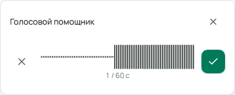

# VOICE-REBUILD-20261105 — запись и голосовое управление

Повторное открытие по сообщению владельца: середина записи пропадает, готовое
название задачи вызывает повторное уточнение; требуется минимальное окно записи
с реальной звуковой линией. Предыдущий scoped PASS не доказывал работу физического
микрофона. Рабочий срез: `C:/Users/user/Desktop/PlatformaCRM`, ветка
`codex/ui-testing-toolkit`, HEAD `66101d50` + собственная dirty delta. Исходные
снимки, план, команды, логи, patch/hashes: `output/voice-rebuild-20261105`.

## Получившееся поведение

- Capture работает на native sample rate, передаёт буферы1024samples, удерживает
  узлы графа и проверяет порядок/число PCM. WAV остаётся mono PCM16/16kHz/60сек.
  Echo cancellation, noise suppression и automatic gain control запрашиваются
  выключенными; настройки ОС/оборудования этим не управляются.
- Состояние записи появляется после первого PCM. Пропавший вход/последовательность,
  mute/ended, processor error, остановка контекста или отсутствие чанков вызывают
  видимую ошибку без отправки обрезка. Тишина не является ошибкой. Stop ждёт flush;
  отмена/закрытие удаляют аудио и отбрасывают поздний результат.
- Начальное окно содержит запись; во время capture видна звуковая линия из
  реальных данных. Текст, уточнение, предложение с подтверждением и ссылка
  результата появляются по сценарию. Постоянная лента карточек и ссылка настроек
  удалены; настройки доступны через существующий раздел/Аккаунт. Ручной ввод
  доступен после ошибки. Контекст открытой карточки остаётся явным opt-in.
- Сервер воспринимает описание работы как название задачи без слова «название».
  Исходная реплика передаётся в field planner напрямую, выбранный шаг — как
  ограничивающий контекст. Ответ на уточнение использует предыдущий диалог.
  Язык UI относится к вопросам, а не к значениям полей.

Доменное исполнение, разрешённые операции, роли/Business, approval/replay,
приватность и политика провайдера сохранены. Новых endpoint/model/migration,
зависимостей, notification/BusinessEvent или working-DB/env изменений нет.

## Доказательства и ограничения

Проверки используют существующие зависимости и `isolated_runtime` с одноразовой
SQLite/портами. Реальные запросы OpenRouter явно входят в разрешённый scope;
остальные внешние интеграции не вызывались. Проверка синтетической речи не
является проверкой микрофона владельца, шума или качества человеческого RU/KK/mixed.

- `node --test frontend/scripts/tests/voice-audio.test.mjs`: 7 PASS, включая
  сохранение каждого sample18сек, середины/тишины/конца, flush и отказ при разрыве.
- `.venv/Scripts/python.exe output/voice-rebuild-20261105/run.py --browser`:
  финальный основной набор9 PASS; RU1440/KK390/EN390, реальный capture,
  редактирование/отправка, approval/result, cancellation/late response, отказ
  устройства, настройки общего recorder и роль403. `--grep 'keyboard recording'`:
  ещё1 PASS — клавиатура/фокус и отмена до выдачи разрешения микрофона.
- Отдельный16-секундный browser WAV проверен по энергии каждые0.5сек: сигнал
  сохранён в начале, середине и конце; `continuity-result.json`. Пять повторных
  стартов/отмен прошли; это не доказательство отсутствия всех аппаратных обрывов.
- `.venv/Scripts/python.exe output/voice-rebuild-20261105/run_live.py`: реальный
  browser→Turbo→пунктуация→preview→подтверждённая Task. Синтетическая речь20сек,
  полный текст с условиями доставки, стоимостью и электронной почтой сохранён
  в описании. Exact API output и отображённая ссылка результата проверены.
- `.venv/Scripts/python.exe output/voice-rebuild-20261105/run.py --build`:
  i18n/types/app+widget PASS. `npm run check:bundle` из frontend: PASS,
  app shell348.4kB; известные RU/KK chunks>500kB остаются предупреждением.
- Backend: focused planner26, clarification7, source-request26, language-policy24
  и промежуточный affected98/system/drift PASS. Окончательный runner `completed`
  после всех серверных изменений:98 PASS, `check` и `makemigrations --check --dry-run`
  PASS. Набор: `apps.ai_core.tests_crm_planner`, `tests_voice_language`,
  `tests_voice_interface`, `tests_voice_policy`, `tests_speech`,
  `tests_speech_formatting`, `tests_conversation_api`, `tests_conversation_state`,
  `tests_conversation_execution`, `tests_conversation_memory`, `tests_agent_runtime`,
  `tests_prompt_preferences` (все с префиксом `apps.ai_core.`).
- `.venv/Scripts/python.exe output/voice-rebuild-20261105/final_probe.py`:3 реальных
  сценария уточнения PASS на окончательном серверном коде. `paraphrase_probe.py`:
  RU/EN/KK3 PASS со строгим сравнением названия в исходном языке; исправления
  проверены на обычных формулировках, не через regex-подстановку команды.
- Повтор `run_live.py` на окончательном capture/server:1 PASS,21.13сек audio,
  полный Task/description и отображённая ссылка результата.

Реальный исходный probe воспроизвёл повторный запрос названия во всех трёх
вариантах: команда, команда после уточнения, короткий ответ после уточнения.
После первого исправления все три подготовили предложение. Дополнительные
формулировки выявили потерю исходной реплики и перевод значений на язык UI.
Сохранены failing логи: `real-flow-before.log`, `paraphrase-before-source.log`,
`paraphrase-translated.log`, `paraphrase-language-conflict.log`,
`paraphrase-routed-wordorder.log`. Дополнительный failing unit-check ожидал raw User input без существующего
префикса `Saved style: expert.`; ожидание исправлено на точную полную строку с
этим префиксом. Проверка исходной реплики не ослаблена. Runner теперь задаёт UTF-8
для диагностик; исходный failing лог сохранён.
Конфликтующая общая language-инструкция
в services ограничена question для двух planning stages; обычные ответы неизменны.

Первый browser-набор:6 PASS/2 FAIL. RU capture завершился ошибкой до waveform;
точная причина первого прерывания без диагностических событий не установлена.
Добавлены диагностический harness, готовность только после PCM и отдельное
окно старта5сек; последующие RU, пять стартов и финальные9 прошли. Вторая ошибка
была в проверке роли: динамический импорт имел отдельное auth-state, затем раннее
закрытие страницы обрывало me-запрос. Harness ждёт загрузку настоящего клиента
и использует авторизацию уже сделанного app-запроса; ожидаемый403 не ослаблен.

Основание технических проверок: [AudioWorklet process и processorerror](https://developer.mozilla.org/en-US/docs/Web/API/AudioWorkletProcessor/process),
[currentFrame](https://developer.mozilla.org/en-US/docs/Web/API/AudioWorkletGlobalScope/currentFrame),
[ограничения media capture](https://developer.mozilla.org/en-US/docs/Web/API/MediaTrackConstraints).
Это описание API; причинность аппаратного дефекта владельца не установлена.

## UI delivery gate

- Hard gate PASS: нет декоративного контента, выдуманных данных и новых внешних
  assets; RU/KK/EN390/1440 без горизонтального overflow, проверки в основном наборе.
- Purpose gate PASS: линия показывает только реальный сигнал; кнопки запускают
  запись/остановку/отмену; draft редактирует данные; preview/approval отражают API.
- Liveliness PASS: движение отражает входящий звук; искусственной анимации нет.
  Существующие шрифт, фон, брендовый цвет и общие Button/Textarea сохранены.
- Craft PASS: рассмотрены desktop/mobile screenshots; клавиатура, возвращение
  фокуса, draft recovery, pending/failed/role states и build проверены.
- Data/access PASS: API-layer и backend-права сохранены; до подтверждения Task
  не создаётся, повтор подтверждения не дублирует результат (backend regression).

[KK mobile](voice-rebuild-20261105-assets/panel-kk.png),
[EN mobile](voice-rebuild-20261105-assets/panel-en.png),
[реальное предложение](voice-rebuild-20261105-assets/live-proposal.png),
[результат](voice-rebuild-20261105-assets/live-completed.png).

Финальный review дополнительно исключил технический action=create из подписи
перехода и заменил длинный loading-текст внутри icon-button на pending indicator.
Три locale flow повторно PASS; после последней правки индикатора отдельный EN
flow PASS, итоговый build/types/i18n/bundle PASS. Всего10 различных scoped browser
сценариев прошли; повторные запуски не увеличивают это число. Scoped working/index
hygiene, registry, новые ссылки/файлы и собственный patch проверены.

## Граница завершения

Код принятого изменения и изолированные проверки завершены. Остаток доказательств:
живая проверка физического микрофона владельца и human RU/KK/mixed/noise; точная
аппаратная причина исходного обрыва не доказана. Остаток среды: publication и
production broker/recovery. Нового решения владельца для реализованного scope нет.
Human microphone/языки/шум, production broker/recovery и полный D01 остаются
отдельной приёмкой. Full E2E/release не запускался: scope ограничен голосовым
потоком. Контракт AI/voice/frontend, roadmap, паспорт и реестр evidence обновлены;
product/access/operations/setup README не меняют описанного поведения/среды.
Существующий `.git/index.lock` от04.11 и17 чужих outgoing commits блокируют
commit/push: они сохранены. Remote main readback `0b3348e1`; собственного commit,
push, нового CI и deployment нет.
