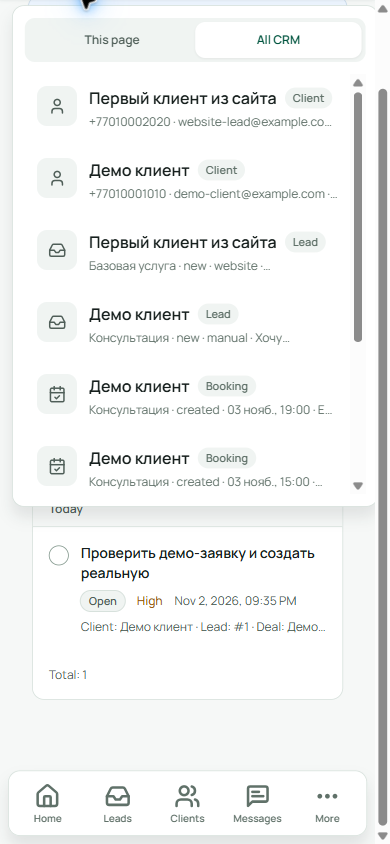
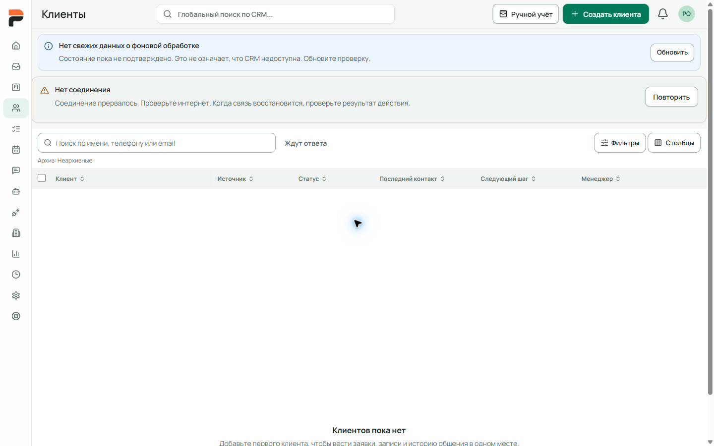
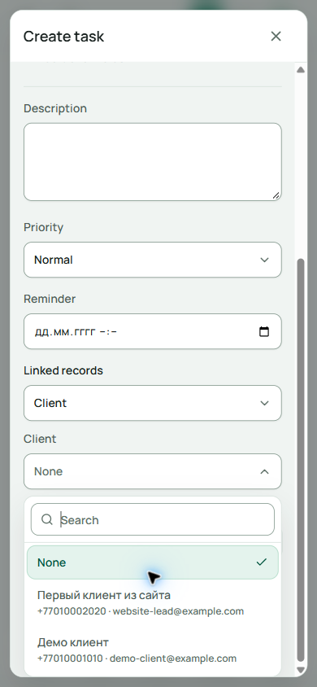
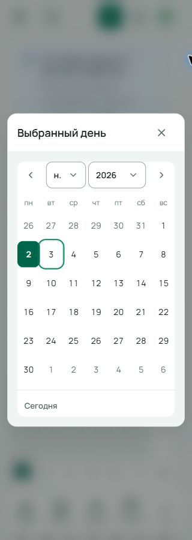

# UI/UX-аудит PlatformaCRM — 02.11.2026

Задача `UIUX-FULL-20261102`: установить оригинальный anti-slop и проверить интерфейс CRM — ошибки, упущения, слабые стороны и возможности улучшения. **Установка выполнена; аудит выполнен на описанном ниже локальном срезе. Исправления продукта не входили в поручение и не выполнялись.**

Главный вывод: наиболее важны надёжность восстановления, полнота поиска и доступность управления, а не смена визуального стиля. Есть один дефект P1 и ряд P2/P3. Таблицы, карточки, нейтральная палитра и повторяемые элементы сами по себе не являются недостатками.

## Установка и метод

Оригинальные `antislop`, `antislop-ui`, `antislop-copywriting`, `antislop-code`, `antislop-human`, `antislop-layoutmobile` установлены в `C:/Users/user/.codex/skills/`. Источник: [upstream на закреплённой ревизии](https://github.com/miqdadbadjuber/anti-slop/tree/941b1532f9cc8ffde766bca5921d75257c9e5762). SHA-256 всех десяти файлов из каталогов skills совпали с исходником, включая VERSION, справочники и дополнительную лицензию. Приложение и его зависимости для этой установки не переустанавливались. Новые глобальные skills обнаруживаются новой сессией Codex; в этом аудите инструкции прочитаны непосредственно.

Также использована локальная проектная адаптация `.agents/skills/zani-audit-ui-purpose/SKILL.md`, созданная другой задачей и ещё не опубликованная в исходном HEAD: это не результат данного аудита. Установка оригинала не заменяет проектные правила. Требования anti-slop применены как вопросы к качеству, а не разрешение переписать интерфейс, удалить функциональные блоки или добавить декор.

Проверка: маршруты и исходники, импортирующие компоненты потребители, реальный браузер, клавиатура, DOM/axe 4.12, снимки и точечное воспроизведение отказов. [Манифест](uiux-full-20261102-manifest.json) содержит исходные хеши, изменения за время проверки, 302 файла инвентаря компонентов/страниц с импортами, 97 сырых сканов и подтверждение установки. Инвентаризация файла **не означает** проверку каждого его состояния. Сырые сканы включают ранние загрузки; выводы ниже имеют приоритет над их автоматическими предупреждениями.

Рабочая папка `C:/Users/user/Desktop/PlatformaCRM`, ветка `codex/ui-testing-toolkit`, HEAD `e02a28f550e94a543c3d88acac7c1b19ee48f90b` плюс сохранённый чужой WIP. Изолированные backend `56680`, frontend `56681`, синтетическая SQLite, mock AI, внешние соединения заблокированы. Рабочая БД и существующий dev-стенд не изменялись. Синтетические входы и языковые настройки менялись только на стенде; для поиска добавлены тестовые задачи. Реальные сообщения, платежи, приглашения, изменения прав и активация интеграций не выполнялись.

Во время проверки параллельно менялись 25 frontend-файлов, включая маршруты, глобальный поиск, словари и новую страницу записей. Это аудит наблюдавшегося рабочего среза, **не сертификат неизменного релизного кандидата и не приёмка R01**. Смена Lead/Deal на Appointment учитывается в рекомендациях: не стоит сначала переделывать уходящие рабочие страницы. Их старые данные и история сохраняют собственную ценность.

## Карта покрытия

| Область | Что действительно проверено | Граница |
| --- | --- | --- |
| Главная, заявки, сделки, клиенты, задачи | Заполненные списки RU desktop; mobile для основных списков; фильтры, поиск, карточки, отсутствие результата | Legacy Lead/Deal списки проверены до замены маршрутов; позднее полные legacy-detail маршруты уже заменялись, их прежний runtime не сертифицирован |
| Клиент/задача/запись | Инспекторы клиента и задачи; полные страницы клиента и записи; переход клиент → форма записи; 320/390px | Без сохранения бизнес-команд, вложений и архивации; это UI-аудит, не повторная проверка доменных инвариантов |
| Календарь | Desktop/mobile/768px, месяц, форма записи, выбор даты 320px, стрелки и Escape | Без drag/drop, реальной конкуренции бронирований и всех вариантов расписания |
| Inbox, уведомления, история | Заполненный синтетический Inbox, выбранный диалог, mobile RU/EN; пустой bell, Escape; списки истории | Без доставки сообщений, OS push/звука и полного журнала событий |
| Услуги, ресурсы, график, филиалы | Списки/метрики, mobile/cards и tablet/table, формы услуг и ресурсов 320px, окно графика и возврат фокуса | Формы не сохранены; все специальности/расписания не перебраны |
| Настройки/аккаунт | Сотрудники, приглашение без отправки, права в форме, клиентские сообщения/preview, custom fields, тариф, сессии; RU/KK/EN выборочно | Пользовательские шаблоны сохранены как данные; не менялись права/пароли/MFA |
| AI/боты/подключения/автоматизации | Страницы и пустые состояния; все вкладки агента: профиль, знания, действия, каналы, тест, в том числе 320px | Не отправлялся AI-запрос, не подключались провайдеры; активные и отказавшие live-интеграции не проверены |
| Аналитика/поддержка | Desktop/mobile аналитика, пустые support states, тарифная недоступность | Без полного множества графиков/экспортов/заполненных обращений |
| Роли | Owner; operator: скрытая навигация и отказ на прямом URL настроек; platform admin | UI-состояние отказа не доказывает backend tenant isolation; production MFA не проверена |
| Платформа | Overview1440/390, businesses, карточка бизнеса и её вкладки, operations/incidents, support | Infrastructure loading не засчитан как готовый экран; billing/recovery/access actions не выполнялись |
| Публичные страницы | Login/signup, пустая валидация login, forgot/recover/reset, invalid invite, документы, 404, MFA без сессии | Не принимались соглашения, не создавался аккаунт, не менялись credentials; reset-token submit и юридическая экспертиза отсутствуют |
| Общие компоненты | Input/Textarea/Button/Switch, Select/SearchableSelect, Tabs, ActionMenu, DateRangePicker, Overlay/drawer, таблицы/карточки, header/sidebar/mobile nav, fallback/loading/error | Проверены представители и исходники; не каждый caller во всех ролях/локалях |

Основные размеры: 1440, 390, 768 и 320 CSS px. Последний проверяет узкий reflow, но не равнозначен выполненному тесту browser zoom400%. RU — основной обход; KK/EN — выборочные страницы и поля, а не полная матрица переводов. NVDA/VoiceOver, реальные устройства, все комбинации увеличения текста/контраста и production performance не исследованы. Нулевой axe-результат не означает WCAG-сертификацию.

## Находки

Приоритеты: P1 — потеря работоспособности/восстановления; P2 — существенное нарушение задачи или доступа к управлению; P3 — менее критичная ясность/согласованность. Ниже указаны минимальное направление исправления и проверка, а не утверждение, что исправление уже сделано. Пути исходников относительны корню; строки относятся к наблюдавшемуся срезу.

### UX01 · P1 · Аварийный экран сам падает

`frontend/src/main.tsx:17` размещает AppErrorBoundary выше AppProviders. В аварийной ветке `components/ui/AppErrorBoundary.tsx:49` используется Button; `Button.tsx:19` безусловно вызывает useI18n. После удаления упавшего дерева провайдера нет, fallback выбрасывает `useI18n must be used inside I18nProvider` — вместо восстановления получается пустая страница.

**Доказательство:** повторно наблюдалось при HMR, console сохранена; отдельно воспроизведено рендером реальной аварийной ветки с `hasError=true` вне провайдера. `node output/uiux-full-20261102/boundary-repro-build.mjs` и запуск полученного `.cjs` подтвердили ожидаемое исключение. Это доказательство дефекта, не PASS приложения. Причина не ограничена HMR: та же зависимость присутствует при любом переходе верхней границы в fallback.

**Предложение:** аварийная поверхность без зависимостей от упавших провайдеров либо гарантированно доступный минимальный контекст. **Приёмка исправления:** принудительный сбой потомка, видимый recovery, работа reload/home, отсутствие второго исключения. Существующий regex-тест этого не доказывает.

### UX02 · P2 · Глобальный поиск не видит задачи за первой страницей

`components/layout/GlobalSearch.tsx:68` использует tasks из `hooks/useEntityData.ts`, где вызывается `tasksApi.list()`. `api/crud.ts:16` распаковывает одну страницу. Поиск фильтрует загруженный массив, хотя интерфейс обещает искать по CRM.

**Воспроизведение:** на изолированном стенде 57 задач; целевая низкоприоритетная задача ID57 отсутствует в первой странице50. API с search возвращает1, поиск страницы задач её находит, глобальный поиск сообщает отсутствие результата. Доказательства: `global-search-pagination-fixture.json`, `global-search-missing-task-dom.txt`, `task-page-search-found-dom.txt` в локальном evidence. Поздняя доработка поиска записей не исправляет этот путь tasks.

**Предложение:** серверный поиск задач с явными loading/error/pagination, как у клиентов; не загружать всё без ограничения. **Приёмка:** совпадение за первой страницей, пустой результат, API failure/retry, смена Business/роли. Аналогичные массивы диалогов требуют отдельной проверки, их дефект здесь не объявляется воспроизведённым.

### UX03 · P2 · Фокус уходит в скрытую мобильную шапку

`components/layout/Header.tsx:78`: шапка уезжает через transform, но её элементы остаются в Tab-порядке. При прокрутке и переходе Tab от «Ещё» фокус попал на меню с координатами выше экрана, затем на поиск; Enter открыл поле также выше viewport. Доказательство: `mobile-header-focus.json`, снимок ниже.

**Предложение:** показывать шапку при focus-within/клавиатурном переходе и сохранять видимость открытого поиска. **Приёмка:** Tab/ShiftTab при разных направлениях прокрутки, открытие поиска и меню, видимый focus; не удалять клавиатурный доступ ко всей навигации.

### UX04 · P2 · Ошибка загрузки клиентов сопровождается ложным пустым успехом

`features/clients/ClientsPage.tsx:306–350` показывает ErrorState, но продолжает рисовать таблицу с пустыми rows/нулевым итогом. При блокировке `/api/clients/*` получены одновременно «Нет соединения», сообщение об отсутствии клиентов и total0. После снятия блока и retry вернулись2 клиента.

**Предложение:** отдельно моделировать ошибку первой загрузки, честно помеченные устаревшие данные и успешную пустоту. **Приёмка:** first-load503, повтор, refresh failure с существующими данными, действительно пустой бизнес и пустой фильтр. Доказательства: `clients-network-error-dom.txt`, `clients-recovered-dom.txt`.

### UX05 · P2 · SearchableSelect не имеет полноценного доступного поведения списка

`components/ui/SearchableSelect.tsx:160–206`: безымянный listbox содержит textbox и другие элементы; axe фиксирует `aria-input-field-name` и `aria-required-children`. На форме задачи, EN mobile, ArrowDown из поиска не переводит выбор к вариантам; Enter выбирает первый результат. Tab до вариантов работает, Escape закрывает только picker — это полезная существующая часть, которую следует сохранить.

**Предложение:** согласованный combobox/listbox с именем, активным вариантом и управлением стрелками; не просто добавить ARIA к несовместимому дереву. **Приёмка:** loaded/loading/no-match/error/retry, выбранная сущность вне первой страницы, клавиатура и screen reader на представительных callers ClientPicker/форм.

### UX06 · P2 · Семантика общих контейнеров и собственных вкладок расходится

В клиентах/задачах/Inbox и полных карточках есть вложенный main; общий `components/crm/EntityWorkspace.tsx:130` возвращает main внутри AppLayout. `MobileClientCards.tsx:27` ставит aria-selected на article. `Overlay.tsx:311` использует aside с role=dialog, что axe отмечает как недопустимую роль; `Overlay.tsx:259` добавляет отдельный banner внутри модального окна. В `features/tasks/components/TaskInspector.tsx:138` обе вкладки остаются в Tab-порядке, нет связи tab→panel, ArrowRight не переключает вкладку.

**Предложение:** один main уровня страницы, валидные роли контейнеров, согласованный выбор карточек и общий Tabs для инспектора. **Приёмка:** клиентский drawer, задача, полная запись и модальное окно; landmark navigation и tabs реальным screen reader. Наблюдавшиеся предупреждения landmarks — best-practice, а не самостоятельное доказательство провала всех критериев WCAG. Focus trap общего Overlay в проверенных окнах работал.

### UX07 · P2 · Страницы плохо идентифицируются вне визуального контекста

Document title остаётся `PlatformaCRM` при переключении разделов. На основных списках нет h1: визуальный заголовок шапки — generic; mobile login/signup скрывают desktop h1. Полные карточки клиента и записи имеют h1 — проблема не универсальна. Skip-link к рабочей области не найден в layout.

**Предложение:** осмысленные page title, один доступный главный заголовок и переход к содержимому. **Приёмка:** переключение страниц/вкладок браузера, список заголовков screen reader и Tab с начала страницы. Отсутствие h1 само по себе не объявляется автоматическим нарушением WCAG; важен доступный способ понять и найти содержимое.

### UX08 · P2 · Черновик AI ошибочно называется несохранённым изменением

`features/assistant/useAIAgentEditorDrafts.ts:56–63`: editorDirty становится true при неактивном/отсутствующем profile независимо от hasUserEdits. При первом открытии сохранённого draft без ввода показаны «Есть несохранённые изменения», «Отмена», «Сохранить изменения»; тестовая панель требует сохранения. Навигационный блокер использует hasUserEdits, то есть статусы расходятся.

**Предложение:** разделить сохранённый черновик, реальные изменения и готовность к активации/тесту. **Приёмка:** открыть draft без ввода, изменить/отменить/сохранить поле, reload; каждый статус и disabled-action объясняется своей причиной. Доказательства: AI DOM и сканы profile/knowledge/actions/channels/test.

### UX09 · P2 · Неверное приглашение оставляет бесполезную форму

`features/auth/InviteAcceptPage.tsx:88,144`: после ошибки preview продолжает отображаться форма имени/телефона/пароля с disabled submit. На несуществующем токене пользователь получает общую ошибку действия без ясного следующего шага; выглядит как форма, которую можно заполнить, но нельзя завершить.

**Предложение:** отдельное состояние недействительного/истёкшего/отозванного приглашения, доступный безопасный способ запросить новое; retry только для временной ошибки. **Приёмка:** invalid/expired/revoked/network и действующий token. Проверен invalid; остальные сценарии — требования будущей проверки, не выполненный результат. Пароли не задавались.

### UX10 · P2 · В локализованный интерфейс попадают сырые значения и RU-даты

В EN/KK аккаунте сессии форматируются по умолчанию ru-RU: `features/account/ActiveSessions.tsx:51`, `lib/format.ts:7`. В global search и шапке CRM-drawer виден `manual`, в некоторых результатах — enum статусов/приоритета. Это системные значения, в отличие от сохранённых русских названий клиентов/шаблонов, которые переводить нельзя. В RU полной записи подпись «услугу» использует неверный падеж.

**Предложение:** язык передавать форматтерам явно, системные enum отображать через словари, разделить контекстные грамматические ключи. **Приёмка:** RU/KK/EN с датой и системным статусом, длинными значениями; пользовательские данные неизменны. Доказательства: `account-en-dom.txt`, `account-language-before-dom.txt`, `client-drawer-dom.txt`, `appointment-workspace-dom.txt`.

### UX11 · P3 · Заголовок «Главная» на других разделах

`app/routeMetadata.ts:46–54` не включает bots/pricing/automations в header mapping и возвращает dashboard по умолчанию. Наблюдалось на соответствующих страницах desktop. **Предложение:** полное сопоставление маршрутов и заголовков, включая aliases/detail. **Приёмка:** матрица route→visible heading→document title, а не добавление разрозненных строк в страницы.

### UX12 · P3 · Текст разработчика и обещания будущего попали в рабочие состояния

404 (`lib/i18n/ru/core.ts:216–219`) говорит о «безопасной пилотной заглушке» и «проверке основных сценариев». Пустой CRM-dialog (`ru/crm.ts:211`) обещает, что каналы «будут собираться», хотя интерфейс уже содержит интеграции. Страница ботов также использует перспективное описание. Это мешает понять текущее состояние и следующий шаг.

**Предложение:** нейтральная причина отсутствия страницы/данных и реально доступное действие; различать неподключённый канал и ещё не реализованную возможность. **Приёмка:** 404, первый диалог, отключённый провайдер, RU/KK/EN. Не удалять полезные настройки и предупреждения лишь из-за технического термина.

### UX13 · P3 · Reduced-motion применён непоследовательно

`styles.css:187` ограничивает часть loading-анимаций; последующие animate-fade-in/slide-down/pulse-slow остаются без аналогичного ограничения. AppLayout использует fade-in. Auth CSS содержит более полное ограничение. **Доказательство:** исходники; полноценный runtime с системной настройкой не проводился. **Предложение/приёмка:** единая политика reduced-motion с проверкой перехода страниц, loading и overlays. Короткая анимация не объявляется сама по себе нарушением WCAG AA.

### UX14 · P3 · Bell не сообщает состояние раскрытия

`components/layout/NotificationBell.tsx:58–67`: триггер имеет имя, но нет aria-expanded/controls; клавиатурный пользователь не получает явного состояния popup. Escape в проверенном окне работал. **Предложение:** связать триггер и панель и сохранить возврат фокуса. **Приёмка:** открыть/закрыть с клавиатуры, пустое и заполненное состояния, чтение screen reader. Чужая текущая переработка уведомлений не относится к изменениям этого аудита.

## Возможности улучшения — не новые обязательства продукта

1. **Вернуть рабочее место на mobile.** Баннер неизвестного состояния фоновой обработки занимает около190–200px перед основной задачей. На стенде нет worker heartbeat — это ожидаемая среда, не найденная авария. Проверить компактную сводку с раскрытием подробностей для unknown; реальные сбои не прятать. Измерять время до первого рабочего действия и число прокруток, а не просто уменьшать текст.
2. **Сделать состояние сохранения и доступности действий единым.** AI, приглашения и client errors показывают разные версии одной проблемы: интерфейс не всегда различает данные, черновик, отказ и отсутствие готовности. Использовать существующие StateViews и конкретные причины disabled, не вводить новый дизайн-системный слой.
3. **Сохранить контекст при переходе список → карточка → действие.** Есть полезные quick actions, связанные записи и единые формы; при R01 проверить возвращение к фильтру/выбору и отсутствие дублирующих источников истины. Старые Lead/Deal findings направлять в заменяющий workflow, а не оформлять отдельный редизайн уходящих страниц.
4. **Сократить вводную часть повторяемых форм.** В услуге два объясняющих блока стоят перед полями; для регулярного пользователя это дополнительная прокрутка. Оставить необходимую подсказку о длительности у поля, шаблоны — доступным необязательным ускорением. Это предложение проверить сценарий, не разрешение удалить все объяснения.
5. **Отличать сводку от декора.** Метрики услуг/ресурсов, очереди dashboard и статусы имеют API/действия и полезную роль. Где итог может помочь отбору, рассмотреть понятный фильтрующий переход; не превращать любую карточку в кликабельную без ожидаемого результата.
6. **Проверять общие элементы на представителях.** Сценарии верхнего fallback, page2 search, offscreen focus и first-load error полезнее CSS-снимков, которые повторяют реализацию. Для accessibility добавить ручную проверку screen reader, прежде чем обещать соответствие стандарту. Применять пропорциональные проверки проекта.

## Что уже хорошо и что не следует «исправлять» ради anti-slop

- Input/Textarea связывают label и ошибку, используют aria-invalid/description; пустой submit клиента/login переводит фокус к ошибочному полю.
- Вложенный Select закрывается Escape без потери всей формы; общий Overlay удерживает фокус и возвращает его в проверенных сценариях графика.
- Shared Tabs и ActionMenu поддерживают стрелки/Home/End/Escape; DateRangePicker на320px перемещает фокус стрелками и не даёт горизонтального overflow.
- Списки имеют mobile-карточки и desktop-таблицы; услуги на768px сохраняют рабочую таблицу. Формы клиента/записи/ресурса/услуги используют понятные поля и видимые действия.
- Operator получает понятный отказ на прямом URL настройки; обычная работа остаётся доступной при неготовом AI. Тестовая AI-панель объясняет границу теста и внешних эффектов.
- Повторяемая структура, спокойная палитра, border/radius, шрифт и содержательные KPI не являются доказательством «AI slop».

## Отброшенные сигналы и честные ограничения

Ранние contrast failures Inbox возникали во время fade-in: после стабилизации реальные цвета давали проходящий результат. Они **не включены** как дефект контраста. Ранние no-h1 на загружающемся аккаунте/настройках также не используются. Сырые сканы сохранены, а не переписаны в «зелёные».

В графике axe указал scrollable-region-focusable у внутреннего mobile-списка, а не у KPI: у KPI уже есть tabIndex. Без отдельного воспроизведения невозможности прокрутки это оставлено на ручную проверку, не выдано за подтверждённый дефект. Native datetime зависит от locale браузера/ОС; сам по себе русский календарик в EN не доказывает ошибку приложения.

WCAG contrast: normal4.5:1, large3:1 только от18pt regular или14pt bold (около24/18.667 CSS px). Upstream-порог18px для regular не применялся. Target-size24px/исключения и удобная рекомендация44px не смешивались. Основания: [W3C contrast](https://www.w3.org/WAI/WCAG22/Understanding/contrast-minimum.html), [W3C target size](https://www.w3.org/WAI/WCAG22/Understanding/target-size-minimum.html), [APG modal dialog](https://www.w3.org/WAI/ARIA/apg/patterns/dialog-modal/).

Ни один автоматический скан не доказывает финансовую корректность, безопасность backend, реальную доставку, tenant isolation или отсутствие всех дефектов. Нет claims о live readiness, скорости production или полной регрессии. Оригинальный anti-slop-code использован для оценки повторного использования UI-слоёв, но аудит архитектуры всего backend не выполнялся. anti-slop-copywriting/human/ui/layoutmobile отражены в UX03–14 и предложениях, а не в произвольной числовой оценке.

## Порядок дальнейшей работы и результат проверки

Рекомендуемый порядок: UX01; затем UX02–05; затем общий слой UX06–07 и состояния UX08–10; затем UX11–14 и проверка предложений с реальными пользователями. Это рекомендации, не запуск реализации и не параллельный roadmap. Текущее R01 остаётся в существующих [контрактах frontend](../current/frontend.md) и roadmap; аудит его не закрывает.

Проверки документации: SHA-256 установки, JSON/локальные ссылки, наличие evidence, diff hygiene и состав подготовленного собственного changeset. App build/types/full E2E не запускались ради отчёта: продуктовый код не менялся; точечный React-reproducer использован только для UX01. Raw evidence в `output/uiux-full-20261102/` остаётся локальным; подготовленные манифест и четыре иллюстрации не содержат runtime-env, БД или паролей.

**Публикация заблокирована:** первая запись собственного hunk в index отклонена из-за существующего `.git/index.lock`; index остался пустым, lock неизвестного владельца не удалён. Кроме того, обычный push включил бы чужой неопубликованный предшествующий коммит `e02a28f5` (origin/main — `c74e0fa0`). Чужая работа не опубликована. Собственного commit/push/CI этого отчёта нет; локальный результат аудита не выдаётся за публикацию.
